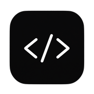

  

<h1 align="center">X Code</h1>

在一个桌面应用里管理 Codex、Claude Code 等编码智能体。

<strong>非官方版本。</strong>基于 T3 Code 源码开发，与 T3 Tools, Inc. 无隶属关系。

  <a href="https://github.com/cxdywhb/t3code/releases"><strong>下载 X Code</strong></a> ·
  <a href="./docs/README.md">文档</a>

## 安装 X Code

1. 在[最新发布页](https://github.com/cxdywhb/t3code/releases/latest)下载适用于 Apple 芯片 Mac 的 `arm64.dmg`。
2. 如果正在使用旧版，先退出应用。打开安装包，把 **X Code** 拖入「应用程序」文件夹，再从那里启动。
3. 在本机安装并登录至少一个编码智能体。例如，安装 Codex CLI 后运行 `codex login`，或安装 Claude Code 后运行 `claude auth login`。
4. 打开 X Code，选择项目目录，新建会话并输入任务。

## 可以用它做什么

- **并行处理任务。** 为不同任务建立独立会话，选择各自的智能体和模型。需要隔离代码改动时，可以为会话创建独立的 Git 工作树。
- **查看和提交代码。** 在应用内查看差异、提交改动、推送分支及创建拉取请求。
- **从其他设备继续工作。** 通过局域网、Tailscale 或 T3 Connect 连接运行智能体的电脑，查看同一组会话并处理授权请求。
- **沿用已有账号。** X Code 调用你在本机登录的智能体，模型用量和费用由对应服务商管理。

## 使用文档

- [安装与首次运行](./docs/user/install.md)
- [接入支持 ACP 的智能体](./docs/user/providers-acp.md)
- [从手机或其他电脑远程连接](./docs/user/remote-access.md)
- [设置权限模式](./docs/user/permission-modes.md)
- [使用版本控制](./docs/user/source-control.md)
- [通过 MCP 连接外部智能体](./docs/user/outside-agents.md)
- [常见问题](./docs/user/faq.md) · [完整文档目录](./docs/README.md)

## 开发与上游项目

本仓库的发布页提供 X Code 桌面安装包。上游 T3 Code 的桌面版、移动端、命令行工具和包管理器安装方式见[上游项目](https://github.com/pingdotgg/t3code)。

从源码运行请参阅[开发指南](./docs/operations/00_development.md#first-checkout)和[架构概览](./docs/internals/01_architecture.md)。向上游提交改动前，请阅读[贡献指南](./CONTRIBUTING.md)。

## 许可证与商标

源代码采用 [MIT 许可证](./LICENSE)。T3 Code 的名称、标志和应用图标受上游[商标与品牌政策](./TRADEMARK.md)约束。公开分发衍生版本时须使用独立品牌，并清楚标明非官方身份。
